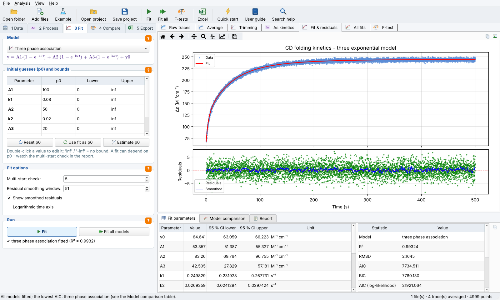

# StoppedFlowKinetiX – stopped-flow CD kinetic analysis of G-quadruplex folding

**StoppedFlowKinetiX** is a Windows desktop application for analysing stopped-flow circular dichroism (CD)
kinetic traces exported from an Applied Photophysics **Chirascan**. It averages the selected repeats, removes
dead-time points, subtracts a baseline, converts the CD signal from mdeg to molar circular dichroism (Δε), fits
exponential kinetic models, compares them and exports everything to a single Excel worksheet.

Version 2.0.0 adds this graphical application to the repository. The analysis is that of the Jupyter notebook
`G4_stopped_flow_kinetic_analysis.ipynb` (version 1.0.0), unchanged: the tests check that the application
reproduces the notebook's reference results. The notebook remains in the repository and can still be used on
its own.



## Download and installation (Windows)

1. Download `Setup_for_StoppedFlowKinetiX_ver_2.0.0.exe` from the
   [latest release](https://github.com/Filip-droid/chirascan-stopped-flow-cd-kinetics/releases/latest).
2. Run it and follow the wizard. Python is not needed.

The installer is not code-signed, so Windows SmartScreen may show *"Windows protected your PC"*. Click
**More info › Run anyway**. The installer creates Start-menu entries for the program and its uninstaller, an
optional desktop icon, and an optional association of project files (`.sfkx`).

## Features

- Imports Chirascan CSV exports (folder, files or drag & drop) and shows their metadata
- Selects the repeats to average with tick boxes
- Removes points at the beginning and end of the trace, subtracts the baseline and converts mdeg to Δε
  (with sequence presets)
- Fits one-, two- and three-phase association models and one- and two-phase decay models, with editable
  initial guesses and bounds and an option to estimate the initial guesses from the data
- Reports fitted parameters with 95 % confidence intervals, time constants and half-lives
- Calculates R², RMSD, AIC, BIC, the Durbin-Watson statistic and lag-1 residual autocorrelation
- Checks for local minima with a reproducible multi-start fit and warns about suspicious fits
- Shows a model comparison table (ΔAIC, ΔBIC) and runs F-tests of nested models
  (1 vs 2 and 2 vs 3 exponentials)
- Exports to a single-sheet Excel workbook in the notebook's layout, and to a CSV table, PNG plots and a
  text report
- Saves self-contained projects (`.sfkx`) with copies of the data, all fits, the F-tests, the report and
  the window state
- Saves automatically, offers crash recovery and asks before closing
- Help: a quick start, a user guide, a page on models and statistics, the input format and a FAQ, plus
  quick help (orange **?** buttons) for every part of the window and a search over all help pages (**F1**)

## Quick start

Start the program, press **Example** in the toolbar and follow the five tabs on the left:
**Data → Process → Fit → Compare → Export**. *Help › Quick start* walks through them.

## Running from source

Requires Python 3.10 or newer.

```bat
git clone https://github.com/Filip-droid/chirascan-stopped-flow-cd-kinetics.git
cd chirascan-stopped-flow-cd-kinetics
python -m venv venv
venv\Scripts\activate
pip install -r requirements.txt
python main.py
```

The program also runs on Linux and macOS from source; the installer is built for Windows only.

### Tests

```bat
python -m pytest
```

The tests compare the results with the notebook's reference workbook (`example/expected_results_TT3T_10K.xlsx`).
They also check project files, automatic saving, the help pages and the icons.

### Building the installer

Install PyInstaller (`pip install pyinstaller`) and [Inno Setup 6](https://jrsoftware.org/isinfo.php), then run
`BuildInstaller.bat`. It runs the tests, builds the program with PyInstaller (`StoppedFlowKinetiX.spec`) and
writes `installer\Setup_for_StoppedFlowKinetiX_ver_<version>.exe`. The version comes from `src/version.py`.

## The Jupyter notebook

`G4_stopped_flow_kinetic_analysis.ipynb` is the original analysis (version 1.0.0). Open it in Jupyter, run the
cells from top to bottom, and set `directory` to the folder with your CSV files (`example` for the included data).
It needs `numpy pandas scipy matplotlib xlsxwriter jupyter`.

## Repository contents

```text
main.py                              start of the application
src/                                 application source code (model / view / controller)
  modules/                           analysis: reader, processing, models, fitting, export, projects (no GUI)
  views/  controllers/               the PyQt5 interface
  help/                              help pages, quick help, help search
tests/                               automated tests
example/                             example Chirascan CSV file and the notebook's reference results
G4_stopped_flow_kinetic_analysis.ipynb   original analysis notebook (v1.0.0)
resources/icons/  installer_assets/  icons and installer images (drawn by tools/make_icons.py)
StoppedFlowKinetiX.spec  installer.iss  BuildInstaller.bat   building the Windows installer
docs/                                screenshot, release notes
CITATION.cff  LICENSE.txt
```

## Input format

The program reads CSV exports from a Chirascan stopped-flow CD instrument. Each file has a metadata header (date,
temperature, `#Pathlength:`, wavelength and bandwidth) and a `Data:` block with a time column and one column per
repeat. See *Help › Input data format*.

## Notes on model selection

Use the residual plots and the comparison statistics together, not a single number. AIC and BIC penalise extra
parameters; the F-tests ask whether one more exponential improves the fit significantly. Strong residual
autocorrelation, or a Durbin-Watson statistic far below 2, indicates systematic misfit or correlated noise, and the
confidence intervals may then be too narrow. The models are phenomenological: an exponential phase alone does not
prove a distinct molecular intermediate.

## Citation

If you use this software, please cite it using the metadata in [`CITATION.cff`](CITATION.cff)
(DOI [10.5281/zenodo.23059866](https://doi.org/10.5281/zenodo.23059866)).

## Authors

- **Filip Křikava** – analysis (notebook, models, statistics, export). Institute of Biophysics of the Czech
  Academy of Sciences / Masaryk University
- **Jan Palacký** – graphical application. Institute of Biophysics of the Czech Academy of Sciences

## License

MIT – see [`LICENSE.txt`](LICENSE.txt). Copyright (c) 2026 Institute of Biophysics of the Czech Academy of
Sciences.
